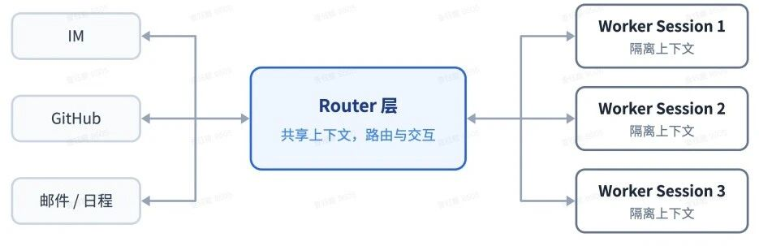
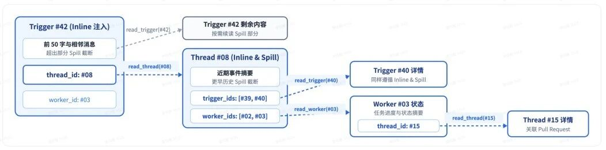
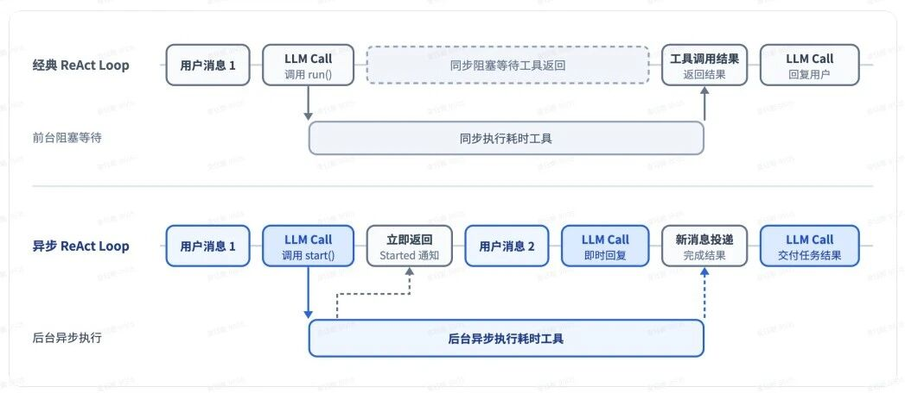

# 读完 Super-agent，我开始重新思考 bot 的交互方式

最近读了 DeepSeek Harness 团队的[《Super-agent 设计探索：迈向更自主的 Agent 系统》](https://mp.weixin.qq.com/s/zoS7GlReWPhfCjENGxXCdg)。文章尝试把 Agent 从一次次手动开启的会话，组织成一个持续在线的协作者：它能接收不同平台的事件，同时推进多项任务，并在上下文之间保持连续性。

我读这篇文章时，一直在拿自己的使用经验对照。一方面，我已经在服务器上运行 PA，知道把一个 bot 保持在线，与让它长期可靠地处理事情，是不同的工作；另一方面，我也习惯在聊天窗口里发起任务，很容易把一个窗口、一个模型会话和一个正在执行的任务，当成天然对应的东西。

文章逐步拆开了这些绑定。我也从 Router 怎么分派、消息怎样过滤，一路追问到引用关系会不会成环、后台任务如何等待用户，以及 Watchdog 究竟在监督什么。到最后，我得到的判断是：**系统可以替人管理底层会话，但人仍然需要看见任务、理解进度，并在适当的位置参与决策。** 后台并发能力越强，这个交互问题就越值得单独设计。

下面记录的是这次阅读中逐步形成的理解。原文提供的原型仓库，我还没有深入研究；文中对数据结构、暂停恢复和界面的推演，会明确作为一种实现思路，不把它们当成原型已经具备的功能。

## 先把任务分派与任务内部的规划分开

文章的双层架构，把 Router 和 Worker 分成了两类职责。Router 接收不同入口的交互，维护任务之间的关联，决定一条消息应该交给谁；Worker 在隔离的上下文里，负责把一个具体任务推进到结果。

我首先留意到的是模型选择。文章认为 Router 的工作往往可以由较轻量的模型承担，Worker 则通常需要配置能力更强的模型。这与我之前接触的“强模型规划，小模型写代码”看起来有些冲突。我当时把 Router 理解成了整个系统的规划负责人，因此觉得越上层应该越需要强模型。

后来我才把两种分层对应到不同的工作范围。“强模型规划，小模型写代码”，通常是在一个任务内部划分职责：规划者深入理解问题，设计方案，拆出边界清楚的步骤；执行者根据这些步骤完成实现。这里对强模型的需求，来自规划本身的复杂性。

文章中的 Router 管理的是多个完整任务之间的分派。它把“修复登录故障”和“排查部署失败”识别为两个任务，分别交给 Worker；后续收到补充信息或叫停请求，再判断应该送到哪里。它不负责把登录故障拆成“查连接池、修改配置、补测试”等具体步骤。

这些任务内部的调查和规划仍然由 Worker 完成。登录 Worker 需要读日志和代码、定位原因、设计修复方案，再实现和验证。**这里的 Worker 已经包含了规划与执行，不能把它直接对应成前一种分层里只负责写代码的小模型。** 因此，外层 Router 可以较轻，负责完整任务的 Worker 反而需要较强的解决问题能力。

*图 1：原文的 Router / Worker 双层架构。图源：[DeepSeek Harness 团队原文](https://mp.weixin.qq.com/s/zoS7GlReWPhfCjENGxXCdg)。*

所以，两种方案的模型选择并不冲突：它们划分的是不同范围内的工作。一个 Worker 内部还可以由强模型制定方案，再把明确的编码步骤交给子 Agent。**选模型时要先看这个节点究竟负责路由、复杂规划，还是按确定方案实现，再判断它需要多强的能力。** 如果 Router 也开始承担复杂的跨任务依赖和优先级安排，它的模型需求当然会变化。

## 统一入口的消息压力，可以通过批处理分担

把职责划清之后，还要考虑另一个问题：多个信道的事件集中进入同一个 Router，它能否及时处理？即使每条消息只需要轻量判断，如果都单独调用一次模型，这个统一入口仍然可能排队。批处理针对的就是这部分调度开销。

这里的一轮，主要指 Router 的一次模型调用。当前调用期间到来的事件先积压，下一次再一起注入，因此一轮可以做出多个路由决定。比如同一批里既有“开始修复”，又有稍后到达的“先暂停”，模型可以结合两条消息判断，不必先启动一个已经被撤回的任务。

Router 主要读取事件和上下文，生成相对简短的决定。合并事件增加了输入，但输入的 Prefill 计算具有并行性，耗时通常不会简单地按事件数量同比增长。因此，单个 Router 的吞吐量可能比“一次只能处理一条消息”的直觉更高。不过，**批处理提高的是有效吞吐，不保证每条消息等待更短**；负载持续超过处理能力时仍然会积压，批次过大也会影响判断准确率。

到这里，我把 Router 的两项设计联系了起来：职责分离让它只做短而轻的决定，批处理让一次调用能够处理多个决定。二者共同降低统一路由节点的压力，但都不能保证任意负载下不拥堵，也不能代替对模型判断能力和队列等待的实际观察。

## 主动观察的价值，要连同理解信息的成本一起计算

事件驱动解决了输入从哪里来，但接入群聊之后，输入会包含大量不需要处理的内容。文章用程序规则和模型判断做两级过滤，这让我接着关心：调用模型之前，程序究竟能判断到什么程度。

群组范围、发送者身份、是否被 @、事件类型和任务标签，都可以成为确定性条件。程序也能做很细的判断，例如只放行测试失败的 CI 事件，忽略成功通知；或者合并同一个事件的重复推送。它的能力边界在于条件是否明确，而不只是筛选粗不粗。

但一条消息是在求助、回顾旧问题，还是单纯吐槽，需要结合语义和上下文。程序层通常只能先划出允许关注的范围，模型再判断候选内容是否需要行动。于是，我追问到了这套机制的成本边界：如果一个群本来就需要持续观察，而里面大部分是闲聊，程序依然难以把这些闲聊准确排除。

在这种情况下，大量内容确实仍然需要模型读取。把多条消息合并判断，可以减少调用往返；使用便宜模型做前置筛选，可以降低部分成本；关键词、抽样或摘要也能缩小输入，但可能漏掉真正有价值的信息。希望广泛发现隐含需求，就需要覆盖更多语义内容。**两级过滤能够降低观察成本，却没有提供一种既不理解内容、又能准确发现所有机会的捷径。**

这个结论直接影响了我对“提前行动”的理解。讨论登录故障时，Agent 可以先查日志、尝试复现；收到会议邀请时，也可以提前核对日程。这些场景具有相对清楚的后续需求，准备工作容易找到方向。

普通闲聊则不同。一个人说最近想换工作，可能是在认真考虑，也可能只是在表达当下的不满。Agent 能准备职位清单，不代表这份清单值得准备。即使是程序故障讨论，也可能只是在回顾历史，不能仅凭话题就认定现在需要修复。

因此，我会把提前行动的判断拆成三个方面：结果有多大概率用得上，准备需要付出多少成本，以及猜错后会造成什么影响。读取日志、形成草稿和整理背景资料，通常比较适合作为低成本的前置准备；真正改变环境或对外提交结果，需要进一步判断。这是我对投机执行思路的理解，并非原文给出的一套完整决策算法。

到这里，我的阶段性判断已经比较明确：**提前行动能减少人等待执行的时间，但机会发现本身需要付费。** 对闲聊占绝大多数的群，持续扫描的成本可能超过提前准备的收益。一个系统具有主动机制，并不意味着每个接入范围都值得开启同样程度的观察。

## 引用图保存关系，Inline 与 Spill 决定每次展开多少

当事件持续进入系统，另一个问题就是模型应该看到多少历史。文章没有把全部信息塞进同一个上下文，而是为 Trigger、Thread 和 Worker Session 等对象赋予 ID，在读取结果中附带关联对象的摘要与引用，让模型逐跳找回需要的信息。

我先把这三种对象区分开：Trigger 是一次具体事件，例如一条群消息或一条 PR 评论；Thread 是一串相关事件，例如一个话题、一个 PR 的讨论；Worker Session 是处理任务的执行会话。Thread 并不一定已经有 Worker：它可能还没被分派，也可能不需要处理。同样，Thread 与 Worker 之间可以存在多对多的订阅关系。

用户在群里问“刚才那个修复评审通过了吗”，Router 可以从当前消息找到所属 Thread，沿着关联找到修复任务的 Worker，再找到对应的 PR Thread，读取评审进展。它需要的是一条有意义的检索路径，无须提前读入所有历史任务。

*图 2：原文的链式召回示意，每次读取都保留继续展开的关联入口。图源：[DeepSeek Harness 团队原文](https://mp.weixin.qq.com/s/zoS7GlReWPhfCjENGxXCdg)。*

我在这里连续追问了几个关系问题。首先，链接并不要求两两存在。Trigger 关联某个 Thread 和 Worker，不能单凭这两条边，就推断 Thread 与 Worker 必须有另一条直接链接；这要由实际的归属、订阅或处理关系决定。一个 Worker 同时关联群聊 Thread 和 PR Thread，也不要求两个 Thread 再直接互相链接，通过 Worker 已经可以找到彼此。

其次，能从 Thread 1 经 Worker 找到 Thread 2，不代表反向必然可达。实际关系可能存在，但读取接口未必暴露全部反向引用。甚至某次返回只 Inline 了部分关联，剩余关系还需要继续查询。因此，“本次结果没显示”与“系统里没有这条关系”也要分开看。

双向链接还会自然产生环，例如 Thread 记录它的订阅 Worker，Worker 也记录所订阅的 Thread。**有环只是关系图的性质，是否反复兜圈取决于检索过程。** ID 引用不会自动把对象无限嵌套展开；实现可以记录已读取对象，设置跳数和调用预算，在信息足够时停止。原文没有给出完整的防循环协议，不能把这些方法当成原型已有的保证。

Inline 与 Spill 则解释了模型每次读到什么。假设一条故障消息附了两千字日志，系统可以直接提供消息开头、Thread 摘要、Worker 状态和相关 ID；完整日志、全部讨论和执行记录留在外面。问“有没有人在处理”时，这些摘要可能已经足够；要分析报错，再读取完整日志。

在这个意义上，Inline 是直接放进当前上下文的内容，Spill 是保留在外部、通过入口按需读取的内容。链式召回利用的正是这些入口：每读一个对象，又获得下一步可能需要的关联。这让我把它理解成一种受预算约束的上下文组织方式。

我还怀疑过 Trigger 直接附带 Worker ID 是否冗余，因为理论上可以先读 Thread，再找到 Worker。后来得到的结论是：如果这条间接路径已经能准确表达需要的关系，直接引用确实不是必需的；但它可以作为检索捷径，减少工具往返。工具也可以临时查询并组装这个 ID，不必在数据库里重复存一份。

理解了引用之后，我又关心这些信息是否会过期。这里需要区分两件事：存储里保存的当前状态，以及模型在先前一次读取中看见的内容。比如 Router 在 10:00 读取 Worker，得到“运行中”；10:02 Worker 完成，程序把它的状态改为“已完成”。此时 Thread 仍然可以引用同一个 Worker ID，不需要替换引用，但 Router 已经读过的那段文字仍然是 10:00 的信息。

因此，更新 Worker 记录解决的是“下一次读取能得到什么”，通知 Router 或让它重新读取，解决的是“模型现在知道什么”。要回答用户“任务完成了吗”，Router 应当接收到完成事件，或再次按 ID 查询，而不能一直拿旧摘要回答。**引用可以保持稳定，引用对象的状态会变化；模型已经读到的内容则需要通过新事件或新读取来刷新。**

多对多关系的更新也可以按这个思路理解。假设 Thread T1 被 Worker A、B 订阅，另一个 Thread T2 也被 A 订阅。T1 来了新消息 E，一种可行实现是先保存一条 E，记录它属于 T1，再从订阅关系中找到 A、B，分别通知它们读取 E。T2 不需要跟着改，A、B 也不需要各存一份 T1 的完整历史。Worker 状态变化时，更新相应 Worker 记录；下次工具返回 Thread 详情时，再按关联 ID 组装最新的相关状态。

还要单独记录每个接收方的处理进度。A 读完了 E，B 可能尚未开始，因此只能说“A 已处理”，不能给 E 标一个全局完成就认定所有任务都跟上了。这样，关系、对象状态与投递进度各自有明确用途。上面是为了理解高效更新而推演的一种实现方式，原文没有给出完整的表结构和更新协议。

Trigger 的保留同样应该区分用途。它退出待处理队列后，仍然可能用于回溯原始要求、理解撤销消息、定位旧任务或补投。**执行结束不等于历史记录失去价值。** 保留多久、如何归档取决于具体产品；原文没有规定统一期限，但仍然承诺可召回的引用，应有可读取的内容或明确的归档、删除状态。

## 异步机制让等待局部化，子 Agent 决定由谁执行

理解上下文之后，我接着追问了运行过程。普通同步工具调用，需要等最终结果返回，模型才能继续。如果命令要运行五分钟，系统又没有其他调度入口，前台对话就可能一起等待。

文章中的异步方式把接口改成启动任务：调用 `start()` 后，先返回“已启动”和任务标识；命令在后台运行，最终结果稍后作为新事件进入会话。工具调用先完成了启动这一步，前台就不必一直等着命令结束。

比如测试还在运行，用户又要求构建项目，系统可以再启动第二个后台任务。它们分别保存状态，前台继续接收消息。如果构建依赖测试成功，则让调度系统维护这个依赖，测试完成后再启动构建。需要等待的是那个依赖步骤，整个对话仍然可以处理其他事情。

*图 3：原文的同步 / 异步 ReAct Loop 时序对比。图源：[DeepSeek Harness 团队原文](https://mp.weixin.qq.com/s/zoS7GlReWPhfCjENGxXCdg)。*

这时我想到了子 Agent：主 Agent 把工作交出去，看上去也能让后台继续运行。两者的差别最后落在等待方式上。主 Agent 如果委派后仍然等待子 Agent 的最终结果，前台流程仍可能被占住。后台即使有多个会话并行，也不自动获得前台异步交互。

放到一个同时使用两种机制的例子里，就容易区分了。我让主 Agent 修复登录故障，它启动子 Agent A 负责读代码、排查和验证，启动接口先返回任务 ID。A 还在运行时，我又要求整理一份接口文档，主 Agent 可以接收这个请求，启动子 Agent B，并继续回答我的补充问题。之后 A、B 分别把结果作为完成事件送回来。

在这个例子里，**多 Agent 负责分工和上下文隔离**：A 专注修复，B 专注文档，各自推进自己的模型与工具循环。**异步机制负责让主 Agent 不必一直等它们完成**：启动后先返回，最终结果稍后送达，等待期间主会话仍可处理新事件。如果启动 A 后就同步等待其最终结果，虽然已经有子 Agent，前台仍可能被卡住。两个机制各自承担一部分工作，合在一起才得到这里描述的交互体验。

我也关心再次调用耗时工具是否会形成“内部 Loop 阻塞外部 Loop”。更准确的理解是，启动后台命令未必会产生另一个模型 Loop。只要第二个任务也通过异步接口启动，系统只是多管理了一个任务；如果这次又调用必须等完成才返回的工具，当前会话仍可能被阻塞。异步能力需要落实到接口和调度，不会因为给系统贴了异步标签就覆盖所有操作。

接下来是人的参与。子 Agent 可以执行到某个节点时发出需要输入的事件，保存进度并进入等待状态。主入口显示问题，用户答复后，再按任务归属送回原会话。这是一种可行协议，但需要框架支持中途通信、暂停和恢复。只有最终结果接口的子 Agent，可能只能提前返回受阻状态，再由主 Agent 后续接续。

这里又形成了一个重要结论：**等待用户可以是一项任务的状态，无须让所有任务跟着等待。** 而且，转交结构化问题可以由程序完成，只有需要消除歧义、合并问题或处理冲突时，才有必要让 Router 额外推理。涉及实际授权时，用户未答复的步骤仍应保持等待，主 Agent 不能替用户把问题判断成已经同意。

异步因此减少了等待的扩散范围，却没有消除任务本身需要人参与的事实。这一点后来也成了我理解交互设计的起点。

## 长期在线，要分别看计算、状态和执行环境

读到计算与状态分离时，我最初以为很多 Agent 已经如此：模型在云端，数据在本地。把两者拆开后才发现，这里还存在一个推进任务的程序。

模型负责推理，harness 则负责组织上下文、调用模型、处理工具返回和调度下一步。即使模型在云端，只要这部分程序运行在个人电脑上，电脑休眠后，云端模型也不会独立接着做事，因为没有程序继续把任务往前推进。

拿我的 PA 来对照，它已经运行在服务器上，也有持久化数据，因此具备了服务器常驻和状态保存的基础。接下来更实际的问题是：如果我想让云端的 PA 排查自己电脑上的网站，它怎样操作那份本地项目？

这里的“执行环境”，指工具真正工作时所处的机器及相关条件。对于这个网站，它包括项目目录和未提交的修改、已经安装的 Node.js 与依赖、本地配置、正在运行的服务，也可能包括浏览器当前的页面和登录状态。执行 `npm run build` 时，实际用到哪份代码、哪个 Node 版本、哪些依赖，都由这个环境决定。

harness 则负责推进任务：准备上下文、请求模型推理、接收工具调用、把请求送去执行，再把结果交回模型。两者在本地编码工具中经常运行在同一台电脑上，但职责可以分开。harness 需要知道“在项目目录执行构建”以及返回了什么，不必亲自承担那次构建所依赖的全部本地运行条件。

执行环境也不是必须留在原地。如果代码和依赖都容易重建，云端新建沙箱就是一种选择。文章关心的是另一种情况：电脑上有未提交代码、特殊配置或已经运行的服务，把仓库拉到服务器上，并不能完整复制这些条件。让工具直接在原来的机器上操作，能够避免重新同步和重建环境时丢掉关键差异。

它之所以可以留在原地，是因为工具请求和结果能够通过网络传递。电脑上运行一个 daemon，接收云端发来的操作，在本机执行，再把输出交回去。例如云端 harness 请求“到 D:/my-site 运行 npm run build”，daemon 就使用这台电脑上的目录、Node 和依赖完成构建，把日志和退出码返回。云端模型读到结果后，再决定下一步。daemon 在这里可以只是一个负责接收、执行和回传的后台程序，无须自己再规划任务。

所以，搬到云端的是持续推进任务的程序，留在电脑上的是这次操作真正依赖的工作条件；它们通过工具接口连接。必要的文件内容和日志仍然会返回云端，但整个环境不用一起搬走。电脑离线时，依赖它的步骤需要等待，云端仍可以处理其他事情。**执行环境的放置由任务条件决定，分离设计让 Agent 可以接入原有环境，也可以使用适合重建的云端环境。**

## Watchdog 提供独立的检查入口，但可靠性仍取决于故障边界

文章安排了一个独立的 Watchdog Session，用定时消息驱动它，除了检查基础设施异常，也让模型判断 Worker 是否有进展、方向是否偏离目标。我起初觉得这些应该由主 Agent 负责，后来才看清它补上的缺口。

Worker 可以自查，Router 可以根据汇报协调和验收。但如果 Worker 一直重复失败的尝试，却没有意识到自己已经停滞，Router 又没有收到新结果，检查就可能迟迟不发生。定时触发的 Watchdog 提供了另一条入口，不依赖用户追问，也不依赖 Worker 主动承认异常。

它的价值在于补充一条独立监督路径，而不是让其他 Agent 放弃检查责任。运行中产生了大量工具调用，也不等于任务取得了实质进展；监督需要对照目标、证据和成果来判断。模型可以参与这种判断，但并不会因此成为绝对可靠的裁判。

**独立 Session 说明逻辑隔离，能应对哪些故障则取决于部署隔离。** 同机独立进程可能救得了主进程异常，却无法在整台服务器宕机后继续工作；如果定时器就在被监控的主循环里，主循环卡死后，检查也可能一起停止。Watchdog 可以沿用计算、状态和环境分离的原则，但具体分离到哪一层，需要对应它准备处理的故障。

所以，单独加入一个监督 Agent 并不会自动带来长期可靠性。真正需要验证的是：发生目标故障时，它能否继续被唤醒，能否拿到有效证据，以及是否拥有可用的处理路径。这也是后续看原型时，我会特别留意的地方。

## 用户需要统一的参与方式，也需要看得见的任务

最后读到交互模式，我觉得前面的疑问终于连在了一起。异步机制允许后台继续执行，多会话管理也可以对用户隐藏，但如果每个 Worker 都频繁来问细节，用户的注意力仍然会被这些任务占满。只剩一个聊天窗口，并不能自动解决这个问题。

这里我逐渐区分了两类负担。一类是维护会话：找到窗口、记住谁知道什么、搬运上下文、把答复送回正确的任务。另一类是参与决策：选择方案、接受取舍、决定是否继续。系统可以承担前一类，后一类则取决于任务需要以及用户愿意交出的自主范围。

因此，统一入口仍然有意义，但它不必把所有交互都压进同一条消息流。比如同时进行登录修复、资料研究和文章修改，用户需要知道哪些任务在运行、哪些等待决定、哪些已经完成。问题可以挂在对应任务和成果上，只在需要及时处理时通过聊天提醒。

修复方案适合在 Issue 或 PR 中结合代码、讨论和验证结果呈现；研究任务可以围绕报告与来源展开；写作则可以直接选中一段评论或改写。用户也可以暂停任务、改变范围，或者接过浏览器完成某一步。这些操作本身就表达了意图，不必全部转成聊天问答。

这样，用户看到“登录修复需要选择方案”时，可以直接进入相关上下文，而不必知道后台是哪个 Worker、使用了哪个 Session。系统负责把操作送到正确的位置。**隐藏底层会话的价值，是减少执行细节和上下文搬运；呈现任务的价值，是让用户保留必要的理解和控制。** 两件事需要一起完成。

对于陪伴型交流，对话本身就是主要体验；对于编程、研究和写作，任务进展与成果同样需要成为可操作的对象。聊天接口的门槛很低，但当长期任务和并行任务增多，如何展示状态、组织决策和允许接管，就需要超出消息列表本身来设计。

这也是我读完后最明确的阶段性结论：后台自主性需要执行能力和调度机制支撑，前台协作则需要把人的注意力用在有价值的决定上。如果 Worker 仍然需要逐步指挥，统一入口只是把问题集中起来；如果它能独立完成大部分工作，再把必要的判断连同上下文交到人面前，这套架构才更接近文章设想的协作者。

接下来读原型仓库时，我想沿着这些已经形成的判断去核对实现：职责如何约束、状态怎样接续、事件如何投递，以及人在中途参与时，系统怎样保留连续性。这样再看代码，应该能更清楚地分辨架构希望达到的目标、当前实现提供的能力，以及仍需产品设计解决的部分。
