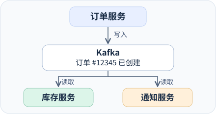
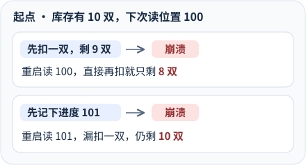

# 我顺着一笔订单，弄懂了 Kafka 在做什么

有人在网上买了一双鞋。下单以后，程序存订单、扣库存，再发一条通知。刚开始学 Kafka 时，我的第一反应是，**就这么三步，一个串行程序也能做完，为什么还要 Kafka？**

## 一个串行程序就能下单，为什么要加 Kafka？

如果这三步本来就该一起完成，按顺序写很自然。让我开始觉得需要改一改的，是另一个场景。订单已经存了，库存也扣了，偏偏发通知的服务卡住。下单程序还在等它回话，用户那边就一直转圈。以后想做销量统计，如果还是沿用这个写法，下单程序里又得多加一个调用。

换一种写法。订单服务存好订单后，往 Kafka 写一条「订单 #12345 已创建」。库存服务来读这条消息，做它该做的事。通知服务也来读同一条，给用户发通知。此时通知服务就算停了半小时，也只会落下它自己的工作。等它恢复，只要消息还在，就能回来接着读。

后来要加销量统计，统计服务也可以来读订单消息。订单服务照常写「订单已创建」，库存、通知和统计各自决定怎么用这条消息。**我需要 Kafka 的时机，是同一件事开始有好几个程序关心，而且这些程序需要按各自的速度做事。** [Apache Kafka 简介](https://kafka.apache.org/intro/)

## 库存已经读过了，通知怎么还能读？

订单数据库里，我能查到「#12345 现在已支付」。Kafka 里可以先有一条「#12345 已创建」，再有一条「#12345 已支付」。数据库里这行记录方便我查订单现在是什么状态。Kafka 里这两条消息方便别的程序知道，订单之前发生过哪两件事。

Kafka 把消息往日志尾部追加。在常见的磁盘存储里，日志分成一段段文件，并用索引定位记录。旧记录什么时候清理，由保留配置决定。库存读过一条，Kafka 还会把它留在原处，通知之后也能读。 [Apache Kafka 存储设计](https://kafka.apache.org/41/design/design/) · [Topic 保留配置](https://kafka.apache.org/40/configuration/topic-level-configs/)

这就有了一个具体问题。通知服务重启时，怎么知道该从哪一条接着读？

假设「订单 #12345 已创建」这条消息在分区 0 的 **100 号位置**。这个位置编号叫 **offset**。

- 库存程序读到 100，扣完库存，然后保存 **101**。库存下次从 101 开始。
- 通知程序刚处理完 99，只保存了 **100**。它现在重启，下次还是从 100 开始，所以仍会读到这笔订单。

这里有两个地方都出现了 `100`。**写在消息上的 `100` 是这条消息的位置。通知组保存的 `100` 是它下次要读的位置。** Kafka 按消费组、按分区保存进度。库存组提交了 101，通知组保存的数字照旧。 [KafkaConsumer API](https://kafka.apache.org/44/javadoc/org/apache/kafka/clients/consumer/KafkaConsumer.html)

## 一个 Topic 为什么要拆成几个 Partition？

我希望跟订单有关的消息都能往 `order-events` 这个名字下发。这个名字叫 **Topic**。订单越来越多时，Kafka 可以把这个 Topic 拆成几条独立的日志，每条叫一个 **Partition（分区）**。几条日志可以同时写，也可以交给不同的程序同时读。

我当时想，从头设计的话，为什么不能干脆建 `orders-0`、`orders-1` 两个 Topic，然后让它们各管一部分订单？可以这么做。只是业务上还有一个问题要回答。库存服务说「我要读所有订单」时，系统怎么知道这两个 Topic 都算进去？以后多一个 `orders-2`，谁告诉写消息和读消息的程序？当我给这几个 Topic 加上统一的名字和分工规则，就又有了两层。**上面一层让业务知道订阅什么，下面一层让系统知道分成几份来做。** 这就是我后来对 Topic 和 Partition 的理解。 [Apache Kafka 简介](https://kafka.apache.org/intro/)

接下来是我最想弄清的地方。**同一笔订单的几条消息，到底会不会跑散？**

发消息时，可以把订单号当 **Key**。以 Kafka Java Producer 的默认有 Key 路由为例，分区数量、分区规则和 Key 的编码都保持不变时，**同一个 Key 的消息都会进同一个分区。一个分区也可以同时存很多不同 Key 的消息。** 比如分区 0 可以先写下「#12345 创建」，接着写「#12347 创建」，再写「#12345 支付」。两笔订单可以交错出现，`#12345` 的两条消息仍然在同一个分区里。

**一个分区里的消息按写入先后排列。不同分区之间没有 Kafka 保证的统一顺序。** 这里的先后是 Kafka 实际写下消息的先后。如果一条业务事件发生得早、发到 Kafka 却更晚，它也可能排在后面。分区 0 的 offset 100 和分区 1 的 offset 100 则是两本账各自的页码，光看这两个数字分不出哪条先写。 [Producer 分区配置](https://kafka.apache.org/41/configuration/producer-configs/) · [Apache Kafka 简介](https://kafka.apache.org/intro/)

所以，**如果业务依赖同一个 Key 的顺序，我会在建 Topic 时就估好分区数，把增加分区当成一次需要评估的变更。** 原来有两个分区时，`#12345` 算出来去分区 0。加到三个分区以后，同一个 Key 可能算到分区 2。旧消息还在分区 0，新消息却去了分区 2，原来靠同一个分区得到的顺序就可能断开。Kafka 可以给已有 Topic 加分区，直接减少分区数则不受支持。 [Apache Kafka 分区变更说明](https://kafka.apache.org/43/operations/basic-kafka-operations/)

## 库存服务开了两个进程，谁读哪个分区？

假设订单有两个分区，库存开了 A、B 两个进程。我可以手动让 A 读分区 0，B 读分区 1。麻烦的是 A 挂了以后，还得有人通知 B 去接手，告诉它从哪里读，再处理 A 回来后的分工。

Kafka 的 **Consumer Group（消费组）** 可以管这件事。A、B 用同一个组名，表示它们在分同一份库存工作。在常用的消费组模式里，一个分区同一时刻最多分给组内一个成员，一个成员可以负责多个分区。两个分区如果开了三个库存进程，就会有一个暂时分不到活。

通知服务用另一个组名。库存组和通知组都能读分区 0，分别做自己的事。如果它们误用了同一个组名，Kafka 就会把它们当成一组来分工，结果可能是分区 0 的订单被库存读了，通知没读到。**同组分着读，跨组各自读。** [KafkaConsumer API](https://kafka.apache.org/44/javadoc/org/apache/kafka/clients/consumer/KafkaConsumer.html)

我还有个疑问。如果 Kafka 告诉 A「分区 1 也归你了」，A 等手里的消息处理完再去读，有什么问题？单纯多拿一个分区时，应用确实可以安排什么时候处理它。更棘手的是反过来的情况。A 手里还有分区 0 的消息没有处理完，分区 0 却马上要交给 B。B 能依靠的，是库存组**上次已经提交**的位置。A 如果刚扣完库存、还没提交，B 就可能把这条订单再读一遍。

这种重新分工叫 **Rebalance（再均衡）**。一些旧的分配方式会先让整组停下来交接，增量方式可以只交接受影响的分区。对我来说，难点终于具体了。要交接的是分区，真正容易出错的是上一位处理者留下的最后一条消息。 [Apache Kafka 消费组再均衡协议](https://kafka.apache.org/40/operations/consumer-rebalance-protocol/)

## 程序突然挂了，为什么库存可能多扣一双？

回到 100 号消息。鞋有 10 双，库存程序读到这笔订单，要扣一双，然后把进度保存为 101。这是两个动作，程序可以在它们之间挂掉。

如果**先扣库存**，库存已经从 10 变成 9，进度却还停在 100。重启会再读一次 100，直接再扣就剩 8 双。如果**先保存 101**，程序刚存完进度就挂了，重启会从 101 开始，100 那笔订单便漏扣了，库存还是 10 双。

这也是我之前把 `999` 想反的地方。「提交了 999」的意思是下次**从 999 开始**。「999 已经处理完」才对应提交 1000。假如程序一口气拉了一批消息再交给后台线程，拉取进度可能已经往前走了，实际工作却还没做完。手动提交时也一样，如果中间还有一条没做完，就不能把提交位置越过它。 [KafkaConsumer API](https://kafka.apache.org/44/javadoc/org/apache/kafka/clients/consumer/KafkaConsumer.html)

库存这边，可以给每次下单事件一个固定编号，比如 `evt-501`。扣库存和记录「处理过 `evt-501`」放在同一个数据库事务里，并给编号加唯一约束。第一次扣成功，记录也一起存下来。第二次见到同一个编号，程序跳过扣减。**消息可以读两遍，库存只扣一次。** 这就是消费端的幂等。

银行扣款就麻烦一点。银行已经扣了钱，我的程序在记录结果之前挂了，本地数据库只能告诉我「还没确认」。这时候需要用原来的付款编号去查。如果支付渠道支持幂等重试，重试时也要沿用原来的标识。Kafka 能让我再次收到该处理哪笔订单，钱实际扣了没有，得找支付渠道确认。

Kafka 也有自己的事务。如果我的处理过程是从 Kafka 读，再把结果写回 Kafka，可以把输出消息和消费进度放在同一个 Kafka 事务里提交，让下游只读已经提交的输出。库存数据库和银行是另外的系统，它们各有自己的处理边界。 [Apache Kafka 消息投递语义](https://kafka.apache.org/41/design/design/)

## 如果挂掉的是 Kafka 自己呢？

运行 Kafka 的服务进程叫 **Broker**。同一个 Topic 的分区可以放在不同的 Broker 上。一个分区也可以存好几份，比如分区 0 由 Broker 1 接收写入，Broker 2 跟着复制。分区 1 则由 Broker 2 接收写入，Broker 3 跟着复制。

对一个分区来说，负责接收写入的副本叫 **Leader**，跟着复制的叫 **Follower**。这里每个分区各有两份副本，Broker 3 只存了分区 1 的那份。**副本数说的是每个分区存几份，具体哪台机器存哪份，要看副本怎么分配。**

如果 Broker 2 挂了，分区 0 失去的是跟着复制的那份，分区 1 失去的是 Leader。如果 Broker 3 上的副本符合正常选举条件，就可以接手分区 1。Kafka 用 **ISR** 记录哪些副本保持同步。要是眼下没有合格的副本，分区就可能暂时无法写入。 [Apache Kafka 复制设计](https://kafka.apache.org/41/design/design/)

## `send()` 以后，什么时候才算写进 Kafka？

前面用了很多次「把订单写进 Kafka」，代码里实际上是生产者客户端在发。以 Java 客户端为例，调用 `send()` 后，消息通常先进入缓冲区。客户端按分区把消息凑成批，再发给对应的 Broker。攒一批可以少跑几次网络往返，`linger.ms` 控制客户端最多愿意等多久，看看能不能再攒几条。

发出去之后要等什么回信，可以用 `acks` 控制。

- `acks=0` 时，客户端发出去就继续。
- `acks=1` 时，客户端等 Leader 确认。Leader 回信时，Follower 可能还没复制到这条。
- `acks=all` 时，客户端等同步副本都确认。`min.insync.replicas` 还能规定同步副本至少要有几份。比如要求至少两份，而现在只剩一份同步，这次写入就会失败。

这张回执讲的是 Kafka 这边写得怎么样。库存程序可能还没开始读。 [Apache Kafka Producer 配置](https://kafka.apache.org/41/configuration/producer-configs/) · [Topic 副本配置](https://kafka.apache.org/40/configuration/topic-level-configs/)

还有一种情况，Broker 明明已经写进去了，回信在路上丢了。客户端不知道结果，于是自动重试。开启生产者幂等后，Kafka 可以用生产者身份和序号认出这是**同一次发送**，避免多写一条。如果关了幂等，还允许多批消息同时在路上，前一批失败后重试，后一批先写进去，也可能改变写入顺序。

应用代码自己再调用一次 `send()`，就是另一次发送。这也是为什么我会同时关心两个编号。**订单号用来选分区，事件编号用来认出同一次业务事件。** 同一个订单可以有「创建」和「支付」，它们共用订单号，但各有自己的事件编号。重发同一条「创建」事件时，才沿用原来的 `evt-501`。 [Apache Kafka Producer 配置](https://kafka.apache.org/41/configuration/producer-configs/)

## 订单存好了，程序在 `send()` 之前就挂了呢？

这次故障发生得更早。订单数据库里已经有了 #12345，库存却迟迟等不到消息。生产者此时连消息都还没收到，也就没有什么可以重试。

一种做法是在保存订单时，顺手在同一个数据库的「待发送」表里写一行，记下 `evt-501` 和要发的内容。订单与待发消息在同一个事务里提交。下单程序就算随后挂了，后台发送程序也能从表里找到这行，发给 Kafka。这就是 **Transactional Outbox（事务发件箱）**。 [Debezium Outbox 文档](https://debezium.io/documentation/reference/transformations/outbox-event-router.html)

后台程序也可能在发成功之后、标记已发送之前挂掉。它重启后还会看到同一行，可能再发一次。所以这里两头得接上。发件箱让我重启后还找得到要发的消息。库存程序每次看到 `evt-501`，都能查自己是不是已经扣过。

## 真要用起来，我要启动什么？

学完这些，我才问了个很实在的问题。用 MySQL，我知道得先有个数据库服务在跑。用 Kafka 呢？

也是先启动一个服务。本地可以跑一个 Kafka 容器，应用里的生产者和消费者再用客户端库连过去，比如连 `localhost:9092`。可以用命令行建 Topic、发一条消息、读一条消息，也可以查消费组保存到了哪个位置。换成真实项目，发的那头是订单服务，读的那头是库存、通知或统计服务。 [Apache Kafka Quickstart](https://kafka.apache.org/quickstart/) · [消费组管理命令](https://kafka.apache.org/43/operations/basic-kafka-operations/)

我看旧的 Docker Compose 配置时，还问过 ZooKeeper 是不是要单独跑。那类旧配置里确实是两个服务，ZooKeeper 帮 Kafka 管集群信息。Apache Kafka 从 4.0 起使用 **KRaft**，由 Kafka 自己的 Controller 管这些信息。在本地练习时，同一个 Kafka 进程可以同时做 Broker 和 Controller。 [Kafka 4.0 升级说明](https://kafka.apache.org/40/getting-started/upgrade/) · [KRaft 与 ZooKeeper](https://kafka.apache.org/40/getting-started/zk2kraft/)

回到最开始的下单例子，我现在能说清楚 Kafka 帮了哪一步。订单服务把发生的事写下来，库存、通知和统计可以各自处理。哪个服务停过一阵，回来就从自己的进度接上。以后遇到类似的需求，我会先想有几个服务要读这份记录、它们要不要各自补处理，再决定是否需要 Kafka。
