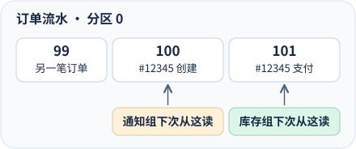

# 我顺着一笔订单，弄懂了 Kafka 在做什么

我刚开始学 Kafka 时，只听过名字。我想先看看，平时写一个下单接口的时候，什么地方会冒出「这里也许需要 Kafka」这个念头。于是我们拿一双鞋来举例。有人买了鞋，系统得存订单、扣库存、发通知。讲到这里还挺简单，直到我问，**如果银行已经扣了钱，支付程序却在记下结果之前挂了，Kafka 能帮我知道这笔钱扣过了吗？**

从这个问题往下，我才慢慢把不同的事分开。谁记着发生了什么，谁记着自己读到哪里，谁又能确认钱确实扣掉了？这篇文章就沿着当时的问题走一遍。

## 下单成功，为什么还得等通知发完？

假如我写了一个下单接口，代码先存订单，再叫库存服务扣库存，最后等通知服务发完消息才返回。通知发得慢，页面就一直转圈。后来产品经理说还要做销量统计，我又得给下单接口接一个统计服务。

加上 Kafka，我可以让订单程序写一条「订单 #12345 已创建」。库存程序自己来读，通知程序也读同一条。加一个统计程序，它也能来读。哪天通知程序停了半小时，库存可以照常扣，通知回来以后再追自己的进度，只要消息还在。

我当时把 Kafka 理解成一个中间层，让接口早点给用户回一句，后台还有记录可以接着做。这里得看接口答应了用户什么。系统收下了订单，可以说「订单已受理」。如果要说「库存已预留」，就得等那双鞋真的留出来。

## Kafka 到底把什么存下来了？

我当时有两个问题。记录放在哪？读记录的人怎么知道自己该从哪条开始？

拿这笔订单来说，我从订单数据库里可以查到「#12345 现在已支付」。如果应用发布了订单事件，Kafka 里可以有两行流水，「#12345 已创建」和「#12345 已支付」。前者方便我看订单现在怎么样，后者方便别的程序知道刚发生了什么。要是业务没把某件事发出来，Kafka 的流水里就没有这一条。

在常见的本地磁盘存储里，Kafka 把每个分区的流水写成一段段文件，新记录往尾部追加。每段还有索引，客户端给出位置后，Broker 可以据此找到文件里的相关地方。普通保留策略可以按时间或大小清理旧的日志段。库存读完一条，通知照样能来读，因为消息什么时候清理有自己的规则。 [Apache Kafka 存储与保留设计](https://kafka.apache.org/41/design/design/) · [Topic 配置](https://kafka.apache.org/40/configuration/topic-level-configs/)

那读到哪了呢？我的第一反应是在消息上盖个「已处理」的章。可库存扣过了、通知还没发，这个章应当算谁的？

Kafka 给分区里每条消息一个位置编号，叫 **offset**。库存组和通知组各留一张书签。库存存下 101，下次从 101 接上。通知还停在 100，恢复以后可以从 100 开始。这两张书签指向的是同一份流水。 [KafkaConsumer API](https://kafka.apache.org/44/javadoc/org/apache/kafka/clients/consumer/KafkaConsumer.html)

这就是我后来记住的两件事。**offset 是消息在一条流水上的位置，提交的 offset 是某个组下次从哪个位置接着读。** 一个组可以读好几条流水，每条都得有自己的书签。

## 看得到历史，为什么还是可能重复扣费？

我当时卡住的地方是，Kafka 明明留着「订单已创建」这条历史呀。程序恢复以后再看一遍，怎么还会重复扣费？

因为「有一笔订单」和「银行已经扣了这笔钱」是两件事。Kafka 能把下单消息再给我一遍。扣没扣钱，得看银行那边实际发生了什么。假如流程有两个动作，「发起扣款」和「在本地记已付款」，把它们换个顺序就能看到问题。

| 挂掉之前做了什么 | 重启时可能看到什么 |
| --- | --- |
| 银行扣完款，本地还没记成功 | 本地看起来没付，再扣一次就可能重复 |
| 本地先记成已付款，还没向银行发请求 | 本地看起来已付，钱其实没扣 |
| 本地只记待确认，同时保存这笔付款的编号 | 重启后有编号可查，知道哪一笔还要确认 |

所以我们聊到了「待确认」这个状态。先保存付款编号，向支付渠道发请求，拿到结果后再把本地状态改成成功或失败。如果发出扣款请求后只得到一个超时，就用原来的编号查结果。渠道支持幂等请求时，也可以带着原来的幂等标识重试。把付款编号换掉，渠道就可能当成又来了一笔。

这也回答了我最开始那个问题。**重播消息可以把工作找回来。要知道工作已经做到哪一步，还得有这个业务自己的记录。**

## 如果从头设计，为什么不用多个 Topic 当分片？

聊到订单多起来时，我们想让几个人同时处理。Kafka 的做法是，一个 **Topic** 给这批相关消息取个名字，例如 `order-events`。里面再切出几条各自存、各自往后写的流水，每条叫一个 **Partition（分区）**。

我当时问的其实是，假如我从头写一个系统，为什么不能让 `orders-0` 和 `orders-1` 都叫 Topic，然后在上面做调度？如果只说「Kafka 里 Topic 本来就是由 Partition 组成的」，等于把结论当成原因。

这样设计当然可以。试着写出库存程序的订阅就能看到差别。如果业务想表达「我关心所有订单」，用多个 Topic 做分片时，某处总得记住 `orders-0`、`orders-1` 属于同一条业务流。新增 `orders-2` 时，它也得自动被算进来。还得有地方规定每笔订单往哪写、几个库存程序怎么分。**只要把这些规则补上，系统里就已经出现了两种东西，整类订单消息，以及用来分工的几条流水。** Kafka 把它们干脆叫出了名字。聊天到这里，我才知道为什么两个概念都有用。 [Apache Kafka 设计文档](https://kafka.apache.org/41/design/design/)

我接着问，每条流水里的记录凭什么放到一起？可以让订单号做消息的 **Key**。在 Kafka Java Producer 的默认有 Key 分区规则下，分区数和路由规则保持稳定，同一订单号会被算到同一个分区。不同订单号也可能算到一起。

| 同一个 Topic | 分区里的实际写入顺序 |
| --- | --- |
| 分区 0 | #12345 创建 → #12347 创建 → #12345 支付 |
| 分区 1 | #12346 创建 → #12346 支付 |

分区 0 里的 #12345 创建事件在支付事件前面，这是这条流水自己的顺序。分区 1 有自己的位置编号，光对着两边的编号看，排不出所有订单的总顺序。另一个容易漏的点是，加分区也不会把旧消息搬到新分区。按 Key 算分区时，同一个订单后续的消息可能改走另一条，所以扩分区还要考虑原先依赖的顺序。 [Producer 配置](https://kafka.apache.org/41/configuration/producer-configs/) · [Topic 扩分区说明](https://kafka.apache.org/43/operations/basic-kafka-operations/)

## 为什么还需要 Consumer Group？

知道了分区，我还是觉得「消费组」有点悬。没有它也能读，对吧？假设我有两个库存程序 A 和 B，我可以写死 A 读分区 0、B 读分区 1。机器一直在线时，这样也能跑。等 A 挂了，我就得自己让 B 接手、记住 A 读到哪里，还要考虑 A 回来时怎么把分区还给它。

同一个 **Consumer Group（消费组）** 里的程序可以分着读。在常用的消费组模式下，一个分区同一时刻最多交给组内一个成员，一个成员可以负责多个分区。库存开三个实例和库存、通知各开一个程序，表达的是两件不一样的事。

| 我想做什么 | 我会怎么分组 |
| --- | --- |
| 三个库存实例一起干活 | 放在同一个库存组，平分能分的分区 |
| 库存和通知都要看到每笔订单 | 用两个组，各自把相关分区读一遍 |
| 同一个库存组开了三个实例，但只有两个分区 | 两个实例读，一个等着 |
| 库存和通知误填了同一个组名 | Kafka 只会在它们之间分分区，各自能看到的订单可能不全 |

我原先把这个关系想成「一边有好几条流水，一边有好几个读者，最后多对多」。这个直觉挺有用，只要在中间加一个条件。**不同组都能去读同一个分区。到了同一个组里，分区交给谁，谁负责这条流水。** Kafka 分的是分区。每条订单消息写进哪个分区，发送时就已经决定了。 [KafkaConsumer API](https://kafka.apache.org/44/javadoc/org/apache/kafka/clients/consumer/KafkaConsumer.html)

## 分区交给我了，为什么不能先做完手里的事？

当时听到「组里来了一个新人，所有人先停下」时，我就觉得奇怪。要是 Kafka 告诉 A，「分区 1 也归你了」，A 等手头这条消息处理完再去看分区 1，不就行了吗？

要看 A 是多拿到一个分区，还是得把自己手里的分区交出去。消费者本来就自己拉取消息。拿到新分区之后，应用可以安排什么时候处理。麻烦的是旧分区交接。比如 A 手里还有分区 0 的一条订单没处理完，B 已经要来接这个分区。A 有哪些进度来得及存下？B 该从哪个位置恢复？这需要有一套交接规则。

| 发生什么 | 接下来怎么办 |
| --- | --- |
| A 挂了，分区 0 交给 B | B 从库存组上次提交的位置接着读 |
| C 加入，只接走原来属于 B 的一个分区 | 新的增量方式可以只交接有变化的分区，其他分区继续读 |
| A 处理完这条订单，来不及存书签就挂了 | B 可能又读到这条，业务得能认出来 |

这种重新分工叫 **Rebalance（再均衡）**。旧式的全量交接会让整组一起停下来协调。增量方式能缩小这次交接影响的范围。交接能把分区交给下一个人，仍然会遇到「上个人有没有把最后这条做完」的问题。 [Apache Kafka 消费组再均衡协议](https://kafka.apache.org/40/operations/consumer-rebalance-protocol/)

## 书签上写 999，重启究竟从哪里接？

聊到这里，我对一个数字问了很久。平常说「我读到 999」，可能是 999 已经读完，也可能是 999 翻开了还没看。Kafka 保存的是**下次从哪里读**。如果提交的是 999，下次从 999 读，有记录的话就先拿到 999。如果我说的是「999 已处理完」，正常提交的应该是 1000。把这两种说法混在一起，整个崩溃例子就会算反。

拿库存里的鞋再算一遍。鞋有 10 双，位置 100 上是一笔需要扣一双的订单。程序要做两个动作，扣库存和提交 101。它偏偏在这两步之间挂了。

这也是自动提交和自己提交值得分开理解的地方。假如我的程序拿到一批消息就交给后台线程处理，Kafka 客户端记下的读取位置可能在业务完成之前往前走。我可以等一批消息真的处理完，才提交下一个位置。如果一批里中间还有一条没做完，也不能把书签跨过去。

| 保存进度的时机 | 崩溃后的取舍 |
| --- | --- |
| 先记下进度，再处理（至多一次） | 可能跳过还没处理的消息 |
| 先处理，再记下进度（至少一次） | 可能重读已经处理的消息 |
| 让处理结果看起来只做成一次 | 需要把进度和处理结果一起管理，或者让重复处理得到同样的结果 |

最后一行里的「只做成一次」也有范围。如果我从 Kafka 读、处理以后再写回 Kafka，可以用 Kafka 的事务机制把输出消息和消费进度一起提交，让下游只读已提交的输出。要是我还得去银行扣钱，银行的结果还是要靠银行确认。 [KafkaConsumer API](https://kafka.apache.org/44/javadoc/org/apache/kafka/clients/consumer/KafkaConsumer.html) · [Apache Kafka 消息投递语义](https://kafka.apache.org/41/design/design/)

我当时接着问，既然书签只能定位，该由谁给「这个事件已经扣过库存」做记号？而且扣库存和做记号是不是也得一起做？库存和这个记号如果都在同一个数据库里，我可以在一个事务中扣一双鞋、写下 `evt-501` 已处理，给事件编号加上唯一约束。这两步一起成功或一起撤销。下次重读 `evt-501`，库存程序就知道已经扣过了。这就是消费端的**幂等**在这个例子里的样子。

## 同一个 Topic，为什么能放在几台机器上？

前面说的是库存程序挂了。Kafka 自己也靠服务器运行，每个负责存和提供消息的 Kafka 进程叫 **Broker**。一个 Topic 下面的各个分区可以放在不同的 Broker 上。同一个分区还可以有几份副本。

每个分区有一份负责接收写入的副本，叫 **Leader**。其他副本叫 **Follower**，会从 Leader 复制数据。我当时追问，那是不是每台 Broker 最后都摆满了所有分区的副本？

| 副本因子设成 2 | Leader | Follower |
| --- | --- | --- |
| 分区 0 | Broker 1 | Broker 2 |
| 分区 1 | Broker 2 | Broker 3 |

这张表里，Broker 1 只有分区 0，Broker 3 只有分区 1。每个分区有两份，每台机器存了哪些要看副本怎么分配。如果这里每个分区设成三份，刚好只有三台 Broker，这三个 Broker 才会各有一份。

Broker 2 挂掉时，分区 0 只是少了一份副本，分区 1 则要重新选负责写入的人。如果 Broker 3 上的分区 1 已经跟上，符合正常选举条件，它就能接手。Kafka 把跟得上的那批副本叫 **ISR（同步副本集合）**。没有符合条件的副本时，正常选举只能先等，不能保证立刻恢复写入。这里在换的是一条流水由哪台 Kafka 机器收消息。前面库存组在换的是由哪个库存程序读这条流水。 [Apache Kafka 复制设计](https://kafka.apache.org/41/design/design/)

## 我调用了 send，Kafka 就收到消息了吗？

我聊完消费和副本以后，才回头看发消息这一边。订单代码里调用 `send()`，真正发消息的是 **Producer（生产者）** 客户端。以 Java 客户端为例，消息进缓冲区，客户端按分区攒批，再发给负责的 Broker。忙的时候，攒批能少跑很多趟。空闲时要不要多等一小会儿攒几条，可以看 `linger.ms`。带 Key 的消息按规则挑分区。不带 Key 时，默认会倾向连续用同一个分区把当前批攒起来，之后再换。

我下一步要问的是，程序什么时候能对自己说「这条写进去了」？这要看 `acks`。

| 配置 | 生产者等哪种回信 |
| --- | --- |
| `acks=0` | 发出去就继续，生产者不等 Broker 的回信 |
| `acks=1` | 等 Leader 确认写入，Follower 可能还没跟上 |
| `acks=all` | 等当时跟得上的同步副本确认，`min.insync.replicas` 还可以规定至少要有几份 |

举个例子，分区原来配了三份，眼下只有两份保持同步。如果 `min.insync.replicas` 设成 2，这两份确认就够。如果只剩一份同步，写入就会失败。这个回信告诉订单程序 Kafka 这一边写得怎么样，库存那头可能还没来读。 [Apache Kafka Producer 配置](https://kafka.apache.org/41/configuration/producer-configs/) · [Topic 配置](https://kafka.apache.org/40/configuration/topic-level-configs/)

## 回信丢了，重试到底会不会发出第二条？

这段讨论里我后来特意分清了两种「再试一下」。假设 Broker 已经把订单写进流水，只是回信没传回来。Producer 不知道第一趟已经到达，于是从内部重试同一次发送。开启**生产者幂等**时，Kafka 能用 Producer 身份和序号认出来，防止这次重试多写一条。关了幂等、又允许多个批次同时在路上时，前一批失败重试、后一批先到，还可能改变写入顺序。

另一种情况是，我的应用捕获错误后主动再调用一次 `send()`，哪怕订单号和内容都一样，也可以是一次全新的发送。订单 #12345 原本就可能有「创建」「支付」两条消息，所以用订单号做 Key，也不能拿它判断是不是同一次事件。

| 我看到的现象 | 该用什么识别 |
| --- | --- |
| Producer 在内部重试同一次发送 | 生产者幂等用客户端身份和序号识别 |
| 程序自己又调用了一次 `send()` | 同一业务事件要沿用同一个 `eventId` |
| Kafka 里只有一条记录，库存组把它读了第二遍 | 库存按 `eventId` 确认这次有没有扣过 |

对照着看，之前说过的「库存扣两遍」和这里的「Kafka 里写了两条」就接起来了。两种情况在流水里留下的东西不一样，库存都需要认得自己已经做过的事。 [Apache Kafka Producer 配置](https://kafka.apache.org/41/configuration/producer-configs/)

## 如果程序刚存完订单，连 send 都没来得及调用？

这题是从上一题顺出来的。Producer 可以重试已经交给它的消息。如果程序刚写完订单数据库就崩溃，Producer 还没见过这条订单消息。用户下了单，库存却可能一直等不到。

我们聊到的办法叫 **Transactional Outbox（事务发件箱）**。还是用同一个数据库，保存订单时，顺手在「待发消息」表里放一行。订单和待发消息一起成功或撤销。以后由后台程序去发，应用一重启也还有地方找回这份没做完的工作。

| 角色 | 动作 |
| --- | --- |
| 订单程序 | 一起存订单和待发事件 `evt-501` |
| 后台发送程序 | 读待发事件，发给 Kafka，确认后再标记已发送 |
| 库存程序 | 读到 `evt-501`，查自己有没有扣过这双鞋 |

如果第二步发成功之后、还没标记就崩溃，发送程序可以再次读到这一行并重发，所以还得保留原来的编号。发件箱保住的是「有一条消息待发」这件事。发给 Kafka 之后，重复的可能性还要继续处理。 [Debezium Outbox 文档](https://debezium.io/documentation/reference/transformations/outbox-event-router.html)

## 真要用起来，我得启动什么？

讲完一圈，我才问了那个最朴素的问题。Python 是写代码的语言，MySQL 是需要先启动、应用再连过去的服务。Kafka 属于后面这种。我可以用发行包启动一个 Kafka 进程，也可以在本机跑一个 Kafka 容器。订单程序、库存程序都有自己的进程，用各自代码里的客户端库连 Kafka。比如连本机的 `localhost:9092`。创建 Topic、手动发一条和读一条、查某个组到哪了，都有命令行工具，也能用 Kafka 的图形化管理工具查看。 [Apache Kafka Quickstart](https://kafka.apache.org/quickstart/) · [Kafka 管理命令](https://kafka.apache.org/43/operations/basic-kafka-operations/)

旧版 Docker Compose 还有个 `zookeeper`，我当时就问它是不是单独跑。那类配置里确实有两个服务。ZooKeeper 帮旧版 Kafka 管理一些集群信息，例如哪些 Broker 在线、谁负责管理集群。消费组是在 Kafka 里分工和保存进度的。Apache Kafka 4.0 起使用 **KRaft**，由 Kafka 自己的 Controller 管集群信息。自己在电脑上学的时候，一个 Kafka 进程可以既充当 Broker，又兼任 Controller。 [Kafka 4.0 升级说明](https://kafka.apache.org/40/getting-started/upgrade/) · [KRaft 与 ZooKeeper](https://kafka.apache.org/40/getting-started/zk2kraft/)

回过头看，我终于能把一笔订单说完整了。订单程序把「下了一单」写进一条流水。Kafka 把流水存下来，几台 Broker 可以分着放，每个分区还能留副本。库存和通知各自来读，谁停了就用自己的书签找回来。真正扣库存、发通知、确认钱扣了没有，还是各自的程序在干。

接下来我想自己跑一次。先发一条订单事件，让库存组和通知组都读到。停掉通知组，继续发几条，再把通知组开回来。如果它从自己停下的位置接上，我就能亲眼看到，两组读的是同一本账，各自夹着自己的书签。
